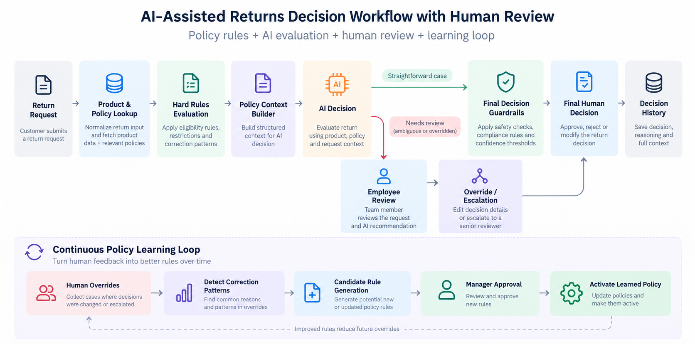
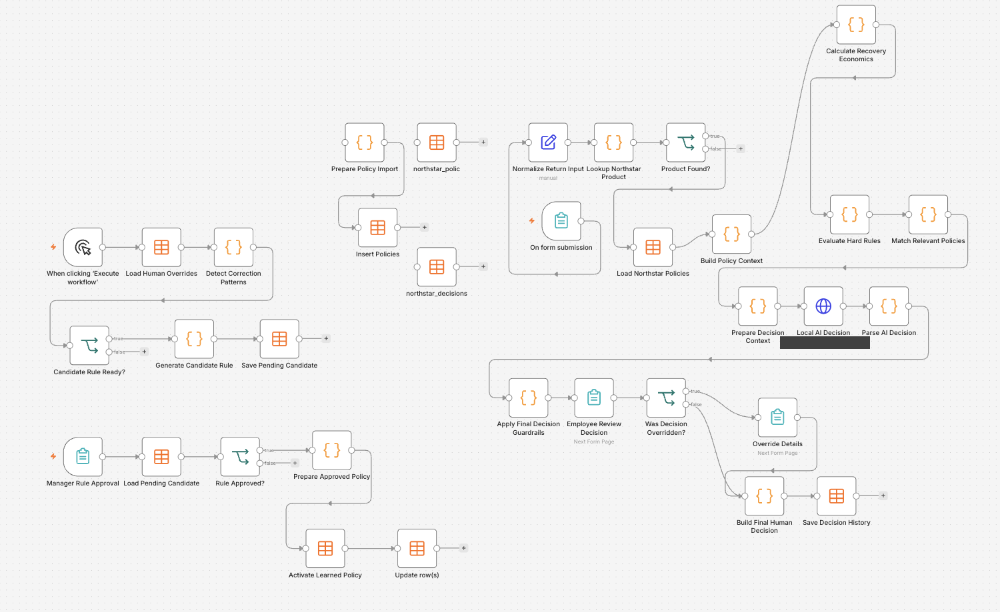
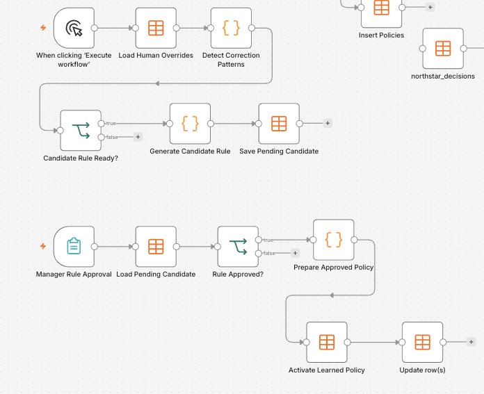

# NORTHSTAR — AI-Assisted Returns Decisions with Human Review

An n8n returns workflow that combines explicit business rules, AI recommendations, employee decisions, and manager-approved policy candidates.



*Original conceptual architecture, cropped to remove its promotional footer. In the actual export, guardrails precede employee review, every completed recommendation reaches the review form, and there is no confidence-threshold gate.*

## The problem

Returns decisions combine fixed restrictions with judgment about condition, resale value, and supplier options. An unconstrained AI recommendation can overlook those restrictions; a wholly manual process repeats the same policy lookups and calculations.

Northstar calculates recovery economics, applies hard rules, selects relevant policy context, and asks an AI endpoint for a structured recommendation. Guardrails resolve the final system recommendation before an employee accepts or overrides it. This is a portfolio implementation with an embedded product catalog and policy seed, not a claim of production results.

## The workflow

```text
Return inspection form → normalize → product and policy lookup
  → recovery economics → hard rules → relevant policy context
  → AI recommendation → parse → final guardrails
  → employee accepts or overrides → saved decision history

Manual analysis of overrides → repeated correction pattern
  → PENDING candidate → separate manager approval → active policy
```

## How it works

1. **Prepare the case.** Match the SKU to the embedded catalog, load policies from n8n Data Tables, and calculate refurbishment recovery versus scrap value and supplier-window eligibility.
2. **Apply deterministic rules.** Specific Code-node rules handle compromised underwear, high-value damaged items, and perfect items with tags. Not every policy labeled `HARD` in the seed is enforced by this Code node.
3. **Constrain AI context.** Match policy conditions and send case data, calculations, and relevant policies to an Ollama-compatible `/api/chat` endpoint. The existing model setting is `hermes3:8b`.
4. **Apply final guardrails.** Validate the action against the allowed list. Matched learned policies can override the AI recommendation; forced hard rules override learned policies; mandatory hard-rule review takes precedence.
5. **Record the human decision.** Every recommendation that reaches this stage is shown to an employee. Save the system action, human action, override reason, matched policy IDs, confidence when applicable, and timestamp.

The supported actions are `RESTOCK`, `REFURBISH`, `RETURN_TO_SUPPLIER`, `SCRAP`, and `MANUAL_REVIEW`. The workflow records a disposition; it does not execute a refund or modify inventory.

## Human feedback and policy candidates

The manually triggered analysis deduplicates decision rows by return ID, then groups corrections by category, condition, original system action, and human action. A group needs at least **three distinct returns** to produce a candidate.

Candidate creation is deterministic JavaScript, not model training. Candidates are saved with `PENDING` approval status. A separate manager form must submit `APPROVE` before the candidate is inserted into the policy table and marked approved. Rejected requests stop on an unconnected branch; they do not update the candidate to a rejected state.

The current approval form loads the first pending candidate and does not display or select its evidence. This is a demonstration of the approval boundary, not a complete approval interface. [Implementation notes](docs/implementation-notes.md) explain the remaining controls.

## Reliability / edge cases

Malformed AI JSON produces a fallback that guardrails initially route to manual review. An applicable learned policy or hard rule can subsequently supersede that fallback. Unknown action strings also fall back to manual review. There is no implemented confidence threshold despite the conceptual graphic's wording.

An unknown SKU is detected, but the false branch has no response node. An AI HTTP failure or missing message content stops execution rather than entering the malformed-JSON fallback. Human overrides are saved without rerunning the hard rules, and neither decision inserts nor candidate generation are idempotent. Deduplication exists only inside correction-pattern counting.

Protect both forms and restrict table writes before adapting this to live use. The export does not implement manager identity verification, authenticated roles, candidate selection, or an atomic activation transaction. Original logic is preserved so these boundaries remain reviewable.

## Tech stack

- n8n forms, Code, IF, HTTP Request, and Data Tables
- JavaScript rules, policy matching, and economic calculations
- Ollama-compatible chat API with requested JSON output
- Employee review, override history, and manager approval branch

## Screenshots



*Original full workflow canvas, cropped; the internal AI endpoint label is redacted.*



*Real canvas close-up: repeated corrections produce pending candidates; the separate approval path activates them.*

## Example

In the [synthetic case](examples/input.json), the AI recommends scrapping a high-value item with major damage. The hard-rule review requirement changes the system result to:

```json
{
  "action": "MANUAL_REVIEW",
  "source": "HARD_RULE",
  "reason": "Company policy requires human approval for this case.",
  "confidence": null
}
```

[Full guardrail output](examples/output.json) and a [pending candidate example](examples/candidate-output.json) are generated from the exported Code nodes using synthetic data. No model or customer history was used to generate these fixtures.

```sh
node tests/smoke.mjs
```

The checks cover guardrail precedence, malformed AI output, allowed actions, and the distinct-return threshold. They do not execute an AI call, n8n forms, or table writes.

## What this project demonstrates

- Business rules around AI-assisted operational decisions
- Structured context and action validation
- Human acceptance and override capture
- Explainable policy matching and recovery calculations
- Separation of proposed policies from approved policies

## Running / importing the workflow

1. Import [workflow/northstar.json](workflow/northstar.json) into an isolated n8n instance with Data Tables and multi-step Forms support. The export is inactive.
2. Create the policy, decision-history, and candidate tables using [the exported column map](docs/data-tables.json) and [setup notes](docs/implementation-notes.md). Rebind every `YOUR_DATA_TABLE_*` selector to your own tables. The policy reader uses the table name `northstar_polic`.
3. Inspect the disconnected table-creation helpers and **Prepare Policy Import** / **Insert Policies** branch. Run the policy import once against an empty development table; it is not wired to the main manual trigger. Review the seed's rule-ID mismatch described in the implementation notes.
4. Replace `YOUR_OLLAMA_HOST` with your own Ollama-compatible endpoint and ensure the configured model is installed. Configure private authentication if your endpoint requires it. No AI credential is embedded.
5. Open **On form submission**, enter a catalog SKU and synthetic inspection details, then complete employee review. Inspect the resulting history row.
6. For the learning demonstration, use distinct synthetic return IDs, run the manual correction analysis, inspect the pending candidate and its evidence directly in the table, then use the manager form in the isolated test environment.

## Notes

Private AI endpoint details, data-table IDs, cached internal links, webhook IDs, and installation metadata were removed or replaced. Node IDs were regenerated. The original workflow was exported under a different filename; its public display name is NORTHSTAR. No decision-history rows or customer data are included. See [publication notes](docs/publication-notes.md).
